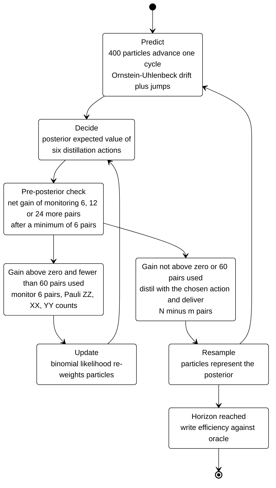
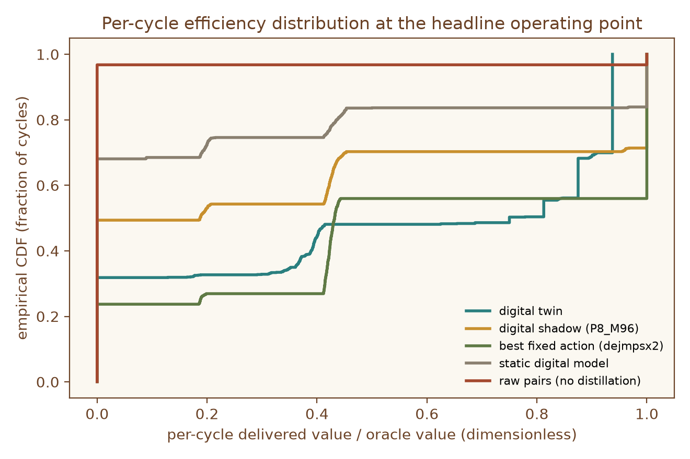
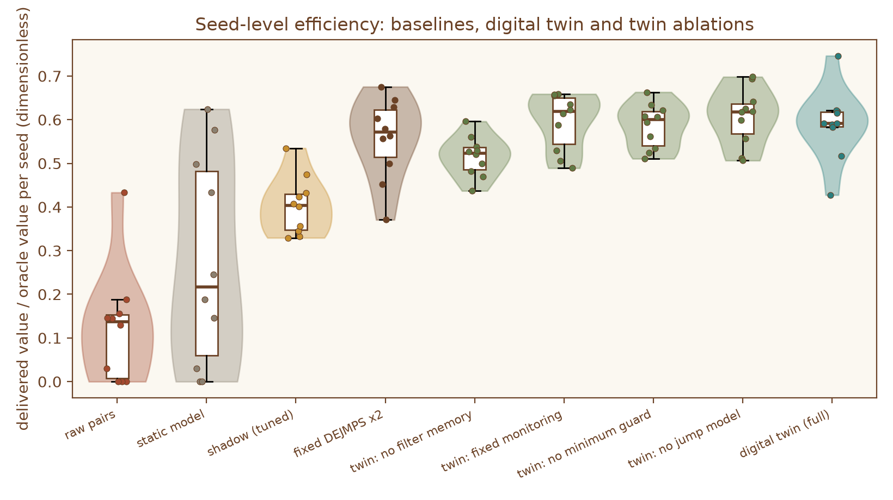
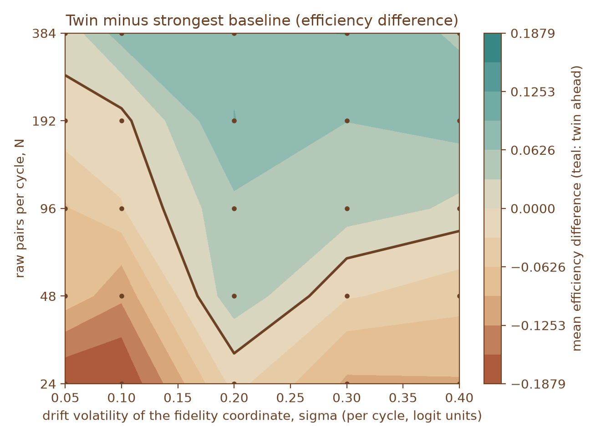
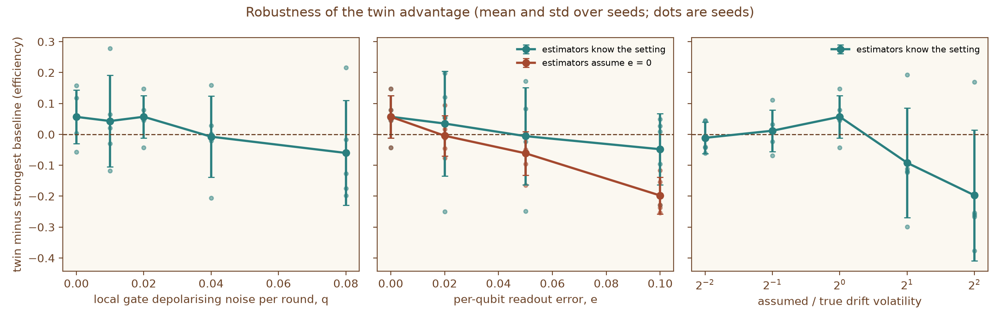

# Does a Digital Twin Pay for Its Own Monitoring Pairs? Entanglement-Link Control under Drift

[](LICENSE)
[](pyproject.toml)
[](.github/workflows/ci.yml)

**Research question.** On a drifting entanglement-distribution link, when does a synchronised digital twin deliver more threshold-meeting entanglement than a periodically recalibrated digital shadow or a fixed distillation policy, once the pairs consumed by monitoring are charged to the link?

**One-line answer (simulation only).** The twin clearly beats the periodic-recalibration shadow (+0.187 efficiency, 10 of 10 seeds), but against the best fixed distillation policy its advantage is confined to fast-drift, large-budget corners of the operating plane (4 of 25 cells with an interval above zero) and is not significant at the headline point (+0.033, interval from -0.025 to +0.093).

## Abstract

We simulate a dephasing-biased two-node entanglement link whose fidelity and noise bias drift, and compare a static digital model, a periodic-recalibration digital shadow, and a particle-filter digital twin with a pre-posterior monitoring rule, all against fixed Deutsch-Ekert-Jozsa-Macchiavello-Popescu-Sanpera (DEJMPS) distillation and an oracle, with every monitoring pair subtracted from the delivered pairs. Efficiency, the delivered threshold-meeting entanglement divided by the oracle's, is 0.590 ± 0.081 for the twin against 0.404 ± 0.066 for the tuned shadow and 0.557 ± 0.094 for the best fixed policy over 10 seeds. A volatility-by-budget phase map and noise, readout and model-mismatch sweeps show where the advantage appears and where it disappears.

## Motivation

Entanglement distribution is the enabling primitive of the staged quantum internet of Wehner et al., 2018 (digital object identifier (DOI) 10.1126/science.aam9288), and it underlies the networks used for distributed sensing and interconnected quantum computers. Real links drift: fidelity and the dephasing share of the noise move with temperature, alignment and memory conditions, and the distillation depth that just meets an application's fidelity threshold moves with them. Too little distillation delivers nothing; too much throws pairs away. Keeping the operator's model synchronised with the link costs pairs, because a measured pair is a pair that is not delivered. The cost of synchronisation is the quantity this project measures.

## Research gap

The systematic review of Elsokary et al., 2027 (DOI 10.1016/j.dte.2026.100149) sorts quantum-network tooling into digital models, digital shadows and early digital twins and finds that true twins with continuous synchronisation "remain undeveloped". The sixth-generation (6G) vision papers (Zhang et al., 2019, DOI 10.1109/MVT.2019.2921208; Chowdhury et al., 2020, DOI 10.1109/OJCOMS.2020.3010270) list quantum communication as a technology but contain no link-level model. In a different field, Mohammed, 2027 (DOI 10.1016/j.cpc.2026.110477) shows that sampling effort should be set online per observable with a minimum-sample guard instead of being fixed in advance. No supplied paper measures the value of a synchronised twin when its own monitoring consumes entanglement. The full related-work table of ten papers is in [`docs/RESEARCH_GAP.md`](docs/RESEARCH_GAP.md).

## What is new here

- A **cost-charged** comparison of digital model, digital shadow and digital twin for an entanglement link: monitoring pairs are removed from the delivered pairs, so a twin has to earn its measurements.
- A **pre-posterior monitoring rule** that decides, cycle by cycle, whether monitoring six, twelve or twenty-four more pairs improves the distillation decision by more than the pairs it burns. It adapts the observable-specific stopping idea of Mohammed, 2027 to a physical resource.
- An **exact validation path**: the closed-form distillation recurrences are checked against an explicit four-qubit density-matrix simulation in the tests.
- A **measured break-even map** over drift volatility and pair budget, including the regions where the twin loses.

## Hypotheses

- **H1.** At the headline operating point (volatility 0.2, 96 raw pairs per cycle) the twin has higher efficiency than the strongest digital shadow. *Supported:* +0.163 against the best-in-hindsight shadow (interval from +0.052 to +0.280, 8 of 10 seeds) and +0.187 against the shadow tuned on held-out seeds (interval from +0.137 to +0.239, 10 of 10 seeds).
- **H2.** The advantage is not universal and has a phase boundary. *Supported:* in 6 of 25 cells the strongest baseline is clearly ahead; in 4 cells the twin is clearly ahead; the rest are inconclusive with five seeds.
- **H3.** Filter memory and cost-aware stopping both contribute. *Partly falsified:* removing filter memory costs 0.074 efficiency, but the fixed-monitoring, no-minimum-guard and no-jump-model variants are indistinguishable from the full twin.

## Method



*Legend: N is the number of raw pairs generated per cycle and m the number spent on monitoring. The branch out of the pre-posterior check is decided by the sign of the expected net gain written in the two target states.*

**Link and drift.** Each raw pair is a Bell-diagonal state with fidelity `F` to the Phi+ Bell state and a dephasing share `w` of the remaining weight. Latent coordinates follow an Ornstein-Uhlenbeck process (correlation 0.95 per cycle) with volatility `sigma` plus occasional jumps. This is an assumed drift model, not a fitted hardware model.

**Actions.** Raw pairs, one or two rounds of the Bennett-Brassard-Popescu-Schumacher-Smolin-Wootters (BBPSSW) protocol, and one to three rounds of DEJMPS, each with local depolarising gate noise `q = 0.02` per round. A delivered pair counts only if its fidelity reaches `F_req = 0.90`.

**Metric.** Efficiency is total delivered threshold-meeting pairs divided by the total of an oracle that knows the true state and spends nothing on monitoring. Outage rate is the share of cycles with zero delivery although the oracle delivers.

**Baselines.** Oracle; raw pairs (classical, no distillation); fixed DEJMPS x2 (the standard quantum baseline) and the best fixed action in hindsight; static digital model (one calibration at cycle 0); digital shadow (recalibrate every `P` cycles with `M` pairs; 24 configurations, reported tuned on three disjoint seeds and best in hindsight on the test seeds). Full details in [`docs/METHOD.md`](docs/METHOD.md).

## Results

Headline operating point: volatility 0.2, 96 raw pairs per cycle, 150 cycles, 10 seeds. Mean ± standard deviation over seeds (file: `results/summary.json`, per-seed rows in `results/headline.csv`).

| Method | Efficiency | Monitoring pairs per cycle | Outage rate |
|---|---|---|---|
| Oracle (upper bound) | 1.000 | 0.00 | 0.000 |
| Raw pairs, no distillation | 0.123 ± 0.132 | 0.00 | 0.762 |
| Static digital model | 0.274 ± 0.241 | 0.32 | 0.536 |
| Digital shadow, tuned on held-out seeds (period 8, 96 pairs) | 0.404 ± 0.066 | 12.16 | 0.389 |
| Digital shadow, best in hindsight (period 32, 96 pairs) | 0.427 ± 0.162 | 3.20 | 0.384 |
| Fixed DEJMPS x2 (also the best fixed action in hindsight) | 0.557 ± 0.094 | 0.00 | 0.187 |
| **Digital twin** | **0.590 ± 0.081** | 9.42 | 0.251 |

Paired difference, twin minus method, with a 10,000-resample bootstrap 95 % interval over seeds:

| Twin minus | Mean difference | Interval | Seeds won |
|---|---|---|---|
| raw pairs | +0.467 | +0.345 to +0.562 | 9 of 10 |
| static digital model | +0.316 | +0.146 to +0.481 | 8 of 10 |
| shadow, tuned on held-out seeds | +0.187 | +0.137 to +0.239 | 10 of 10 |
| shadow, best in hindsight | +0.163 | +0.052 to +0.280 | 8 of 10 |
| fixed DEJMPS x2 | +0.033 | -0.025 to +0.093 | 6 of 10 |



*Figure 1 (pooled over seeds, cycles where the oracle delivers). The twin never reaches the oracle value in a cycle because monitoring burns pairs, yet its median cycle delivers 0.75 of the oracle value against 0.43 for fixed DEJMPS x2 and 0.19 for the tuned shadow. The fixed policy matches the oracle in 44 % of cycles but delivers nothing in 24 % of them, against 32 % for the twin; both statistics are computed from `results/cycle_efficiency.json`.*



*Figure 2. Seed-level spread: the twin and the fixed policy overlap, the shadow and the static model sit clearly below, and removing filter memory is the only ablation that lowers the twin.*

**Ablation** (same 10 seeds; difference to the full twin with its interval):

| Variant | Efficiency | Monitoring pairs per cycle | Difference to full twin |
|---|---|---|---|
| Full twin | 0.590 ± 0.081 | 9.42 | 0 |
| No filter memory | 0.516 ± 0.046 | 10.04 | -0.074 (-0.113 to -0.036) |
| Fixed monitoring, 12 pairs per cycle | 0.596 ± 0.065 | 12.00 | +0.005 (-0.037 to +0.046) |
| No minimum-pair guard | 0.586 ± 0.051 | 3.73 | -0.005 (-0.063 to +0.043) |
| No jump component in the drift model | 0.607 ± 0.066 | 8.98 | +0.017 (-0.023 to +0.057) |



*Figure 3. Phase map (5 seeds per cell, `results/phase_grid.csv`): the twin leads in the fast-drift, large-budget region (teal) and trails the best fixed policy at slow drift and small budgets (brown); the solid line is the zero-difference contour.*

In the 25-cell map the twin is ahead in the mean in 12 cells. Its interval lies above zero in 4 cells (volatility 0.2 with 192 and 384 pairs: +0.095 and +0.088; volatility 0.3 with 192 and 384 pairs: +0.063 and +0.095) and below zero in 6 cells, the worst being volatility 0.1 with 24 pairs (-0.188), where the twin spends 6.0 of 24 pairs on monitoring.



*Figure 4. Robustness (5 seeds, 100 cycles, 96 pairs per cycle): the twin advantage over the strongest baseline shrinks with gate noise, vanishes at 5 % readout error, and turns clearly negative when the readout error is ignored or the drift volatility is overestimated by a factor of two or more.*

| Perturbation | Value | Twin minus strongest baseline |
|---|---|---|
| none (reference, 100 cycles) | q = 0.02, e = 0 | +0.057 ± 0.069 |
| gate noise q | 0.04 / 0.08 | -0.007 ± 0.131 / -0.060 ± 0.170 |
| readout error e, estimators aware | 0.05 / 0.10 | -0.006 ± 0.157 / -0.048 ± 0.116 |
| readout error e, estimators assume 0 | 0.05 / 0.10 | -0.061 ± 0.071 / -0.198 ± 0.059 |
| assumed over true drift volatility | 0.25 / 4 | -0.011 ± 0.051 / -0.197 ± 0.211 |

## Discussion

The result is conditional, and the conditions are informative. Against the digital shadow, the object that Elsokary et al., 2027 identify as the state of practice, a synchronised twin is clearly better, and the reason is visible in the ablation: carrying the posterior across cycles is worth 0.074 efficiency, because the drift is correlated and yesterday's estimate is a good prior. Against a single fixed DEJMPS x2 policy the twin is only +0.033 ahead at the headline point, which is within seed noise. A fixed depth is a strong baseline here because one distillation depth meets the threshold for most of the drift range and monitoring costs pairs. The twin wins when the drift is fast enough to push the fixed policy into outage and the budget is large enough that 9 to 16 monitoring pairs are cheap; it loses when the budget is 24 to 48 pairs or the drift is slow.

Negative and null results. (i) The cost-aware stopping rule did not beat fixed monitoring of 12 pairs per cycle in efficiency, though it used 9.42 pairs instead of 12.00. (ii) The minimum-pair guard lowered monitoring to 3.73 pairs when removed without a measurable efficiency change at this operating point, so the guard's benefit seen in the trajectory-simulation literature is not reproduced here. (iii) The twin has a higher outage rate (0.251) than fixed DEJMPS x2 (0.187): it trades some outages for fewer wasted pairs, which is not visible in an efficiency-only comparison. (iv) The twin is fragile to model mismatch: a readout error that the estimators ignore, or a drift model that is too volatile, removes and then reverses its advantage.

## Limitations

- Classical simulation of Bell-diagonal two-qubit states; no quantum advantage is claimed and nothing was measured on hardware.
- The Ornstein-Uhlenbeck-plus-jumps drift process is assumed; no real link data were used.
- The value function is a hard fidelity threshold, which makes decisions near the threshold costly; a smooth utility would change the break-even map.
- Monitoring uses matched Pauli-basis measurements on whole pairs; no heralding, memory decoherence during classical communication, or multi-hop swapping is modelled.
- Phase-map cells use 5 seeds and 100 cycles, so most cells are statistically inconclusive; the strongest baseline is chosen in hindsight on the same seeds, which favours the baseline.
- Gate noise is a single depolarising parameter per round; the twin knows it.

## Future work

- Fit the drift process to measured fidelity time series from a fibre or free-space link and replace the Ornstein-Uhlenbeck prior by a learned or physics-based one.
- Add heralded generation rates, quantum-memory dephasing while waiting, and entanglement swapping, so that the twin plans over repeater segments instead of one link.
- Use a smooth utility such as a distillable-entanglement or teleportation-fidelity weighting and compare the break-even map.
- Quantify the information-theoretic limit: the Fisher information of the matched-basis counts bounds how few pairs any monitor needs for a given decision error.
- Run the loop against a hardware testbed with an interface where the twin's action, not only its estimate, is executed.

## Reproducibility

```bash
pip install -r requirements.txt
python -m pytest -q                       # 11 tests, about 10 s
python experiments/run_all.py --quick     # smoke run, about 23 s of compute
python experiments/run_all.py             # full study, 970 s wall-clock with 4 worker processes
```

The full run took 970.4 s (about 16 minutes) on a Windows 11 laptop (Intel Core i7-13620H, 16 threads, central processing unit (CPU) only; the graphics processing unit was not used). Numerical libraries are limited to one thread per worker. Seeds are fixed in the code; raw results are in `results/` and figures in `figures/`. Tests include an exact comparison of the DEJMPS recurrence against an explicit four-qubit density-matrix simulation.

## Related work by the author

- [`qfc-codesign-heterogeneous-quantum-links`](https://github.com/pradeepdegalaroyal/qfc-codesign-heterogeneous-quantum-links): noise-aware co-design of quantum frequency conversion for heralded entanglement between heterogeneous memories over fibre.
- [`herald-aware-dynamical-decoupling-spin-memory`](https://github.com/pradeepdegalaroyal/herald-aware-dynamical-decoupling-spin-memory): fidelity loss of a spin quantum memory when the network herald arrives at a random time.

## Project structure

```
src/linktwin/        bell.py (recurrences, actions, values) · density.py (exact check) · drift.py
                     monitor.py (matched-basis counts) · methods.py (oracle, fixed, shadow, twin)
                     study.py · analysis.py · plots.py
experiments/run_all.py   one command for all stages and figures
tests/               recurrence validation, estimator and method checks
results/             headline.csv, phase_grid.csv, robustness.csv, summary.json, cycle_efficiency.json
figures/             four figures, 200 dpi
docs/                RESEARCH_GAP.md, METHOD.md
```

## Citation

```bibtex
@software{degala_entanglement_link_digital_twin_2026,
  author  = {Degala, Chenchupradeep},
  title   = {Digital Twin of a Drifting Entanglement-Distribution Link: Cost-Charged Monitoring and Distillation-Policy Selection},
  year    = {2026},
  version = {0.1.0},
  url     = {https://github.com/pradeepdegalaroyal/entanglement-link-digital-twin-distillation-policy},
  license = {MIT}
}
```

MIT license (`LICENSE`). Machine-readable citation metadata is in `CITATION.cff`.
